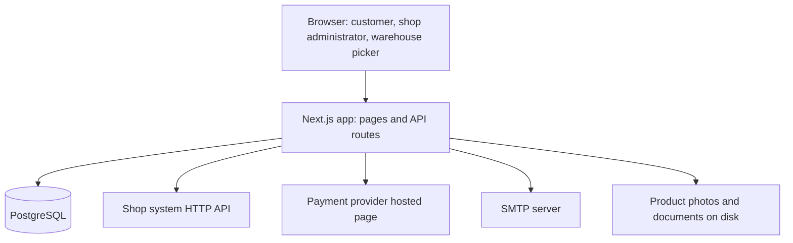

# Design: Ecommerce Portal

## Overview

The Ecommerce Portal is a web app for an existing e-commerce website. Approved business customers sign in, browse the catalogue with live stock and prices in pounds, build a basket and pay by card. Shop administrators approve or reject business customers, manage products, photos and documents, and read a daily orders report. Warehouse pickers pick, pack and ship paid orders.

The portal is not the record of stock or orders: the existing shop system is. The portal reads stock from it, writes paid orders to it, and holds an order when the shop system is down, creating it once the shop system answers again. Card data never touches the portal: payment goes through a hosted payment page of a payment provider, and the portal keeps the provider's reference on each Payment.

Release 1 covers the public catalogue, applying and signing in, the catalogue with prices and live stock, the basket and card payment, a customer's own orders, approving customers, managing products, picking and packing, the daily orders report, the shop system connection with alerts, and account records with an audit trail.

## Architecture

Next.js (App Router) serves both the pages and the API routes from one Node.js process. PostgreSQL holds the portal's own records: Customer accounts, Products, Orders, Payments and the order status audit. The shop system is reached over HTTP with a base URL and an API key from the environment. Email goes through SMTP. Payment goes through the provider's hosted page.

- **Pages** are React Server Components where the data is read-only (public catalogue, catalogue, product page, order lists, reports) and Client Components where the person interacts (application form, sign-in, basket, checkout, admin actions, picking queue).
- **API routes** under `/api` hold the rules: sign-in, application, basket, checkout, admin approval, product management, picking, reports, and the shop system sync.
- **A background job** runs inside the Next.js process on a timer: it retries held orders, checks the shop system connection and sends the down and back emails, and purges records past their retention.
- **A server-side session cookie** (signed, HTTP-only, SameSite=Lax) carries the signed-in person and their role. The Shop administrator's session is only created after the six-digit code is verified.

## Components and Interfaces

### Authentication and roles

- `POST /api/auth/apply` creates a Customer account with status `applied`, checks the email is unused and the consent box is ticked, and sends the "application received" email.
- `POST /api/auth/signin` checks email and password. An approved Customer gets a session and is sent to `/catalogue`. An applied, rejected or suspended Customer gets the "not approved" message and no prices. A Warehouse picker is sent to `/picking`. A Shop administrator gets a six-digit code by email and a pending session; `POST /api/auth/verify-code` completes it and sends them to `/admin`.
- `POST /api/auth/signout` ends the session and redirects to `/`.
- Passwords are hashed with bcrypt. The six-digit code is stored hashed with a 10-minute expiry and is single use.

### Catalogue and products

- `GET /api/catalogue` lists active products with name, photo, price in pounds and stock read from the shop system. It is cached for a short time and served from the last known stock when the shop system does not answer, with the label "Stock last checked at <time>".
- `GET /api/catalogue/:id` returns one product with description, photos, price, stock and documents.
- `GET /api/public/catalogue` and `GET /api/public/catalogue/:id` serve the public catalogue at `/` with no prices.
- `GET /api/files/:id` streams a product photo or document for download.
- `POST /api/admin/products`, `PATCH /api/admin/products/:id` and `POST /api/admin/products/:id/files` let a Shop administrator create and change products and upload photos and documents.

### Basket and checkout

- The basket is kept in the portal's database against the Customer account, so it survives a page reload.
- `POST /api/basket/items` adds one of a product; `PATCH /api/basket/items/:id` changes a quantity, capped at the stock level the shop system shows; `GET /api/basket` returns the lines and totals.
- `POST /api/checkout` takes the delivery address, creates a Payment with the provider, and returns the provider's hosted page address. `POST /api/payments/callback` receives the provider's result:
  - success: the order is written to the shop system with status `paid`; on success the portal stores the order with its number and shows the confirmation;
  - shop system down: the order is stored as `held` and the customer sees "Your order is held until the shop system is back.";
  - card failure: no order, the basket is unchanged, and the customer sees "Your card was not charged. Please try again.";
  - stock fallen below the line quantity: no order, and the customer sees "Stock for <product name> is now <stock level>. Please change your basket."

### Orders, picking and reports

- `GET /api/orders` lists the signed-in customer's orders newest first; `GET /api/orders/:id` returns one order only when it belongs to that customer, otherwise "Order not found."
- `GET /api/picking` lists paid orders oldest first; `POST /api/picking/:id/picked`, `/packed` and `/shipped` move an order through its states and record the picker and the time; `POST /api/picking/:id/missing` cancels the order and emails the Shop administrator.
- `GET /api/admin/reports/daily?date=` returns the day's orders in UK time; `GET /api/admin/reports/daily.csv?date=` downloads the same rows as CSV.
- `GET /api/admin/customers`, `POST /api/admin/customers/:id/approve`, `/reject` and `/suspend` change a Customer account's status and send the matching email.

### Shop system connection

- `lib/shop-system.ts` wraps the shop system's HTTP API: `readStock(productIds)`, `createOrder(order)` and `ping()`.
- A held order is retried in the order it was paid. When the shop system answers again, the held orders are created, keep their order numbers, and the Shop administrator gets the "connection is back" email.
- A connection check runs every 30 seconds; 60 seconds without an answer sends the "connection is down" email once, not on every check.

### Audit and retention

- Every order status change writes an `OrderStatusEvent` with the status, the person and the time.
- A daily job deletes the contact name, email and delivery addresses of a Customer account when deletion is requested, keeps the orders, and purges records past their retention (Customer accounts 2 years after closing, Products 3 years after the last sale, Orders and Payments 7 years).

## Data Models

PostgreSQL, accessed through Prisma.

- **Customer**: id, companyName, contactName, email (unique), passwordHash, deliveryAddresses (JSON), status (`applied` | `approved` | `rejected` | `suspended`), consentAt, deletionRequestedAt, createdAt.
- **StaffUser**: id, name, email (unique), passwordHash, role (`shop_admin` | `warehouse_picker`), twoFactorCodeHash, twoFactorExpiresAt.
- **Product**: id, name, description, pricePence, status (`active` | `out_of_stock` | `discontinued`), createdAt, discontinuedAt. Stock level is not stored: it is read from the shop system.
- **ProductFile**: id, productId, kind (`photo` | `document`), filename, mimeType, path, position.
- **BasketItem**: id, customerId, productId, quantity.
- **Order**: id, orderNumber (unique), customerId, deliveryAddress (JSON), totalPence, paymentStatus (`authorised` | `captured` | `failed` | `refunded`), fulfilmentStatus (`placed` | `paid` | `picked` | `packed` | `shipped` | `cancelled` | `refunded`), held (boolean), trackingNumber, shopOrderId, createdAt, paidAt.
- **OrderLine**: id, orderId, productId, productName, unitPricePence, quantity.
- **Payment**: id, orderId, amountPence, result, providerReference, createdAt.
- **OrderStatusEvent**: id, orderId, status, actorName, actorId, createdAt.
- **ShopConnectionState**: id, lastOkAt, downNotifiedAt, backNotifiedAt.

Money is stored in pence as integers and shown in pounds. Times are stored in UTC and shown in UK time.

## Error Handling

- Every API route returns a JSON body with a `message` the page shows, in the wording the requirements give.
- A shop system timeout is caught in `lib/shop-system.ts` and turned into a `ShopSystemUnavailable` error; the catalogue falls back to the last known stock, and checkout holds the order.
- A payment provider error leaves the basket unchanged and shows "Your card was not charged. Please try again."
- A page a person may not see (another customer's order, an admin page for a picker) returns "Order not found." or redirects to the person's own first screen.
- The background job catches its own errors so a failed retry never stops the next one.

## Testing Strategy

- Unit tests with Vitest for the rules: basket totals, the stock cap, the order state machine, the audit write, the retention purge.
- API tests with Vitest and Supertest against a PostgreSQL database the test setup starts with Testcontainers, with the shop system and payment provider replaced by in-process fakes.
- Component tests with Testing Library for the forms and the basket.
- End-to-end journeys with Playwright in `e2e/`, run only through `run_journeys` against the running app.

## Build and run

Install: npm install
Test: npm test
Run locally: yes
Dev: docker compose up -d --wait && npm run dev
Port variable: PORT
Health path: /api/health
Deploy: managed-cloud

## Test logins

- Shop administrator: `admin@example.com` / `Admin123!`
- Warehouse picker: `picker@example.com` / `Picker123!`
- Approved business customer: `buyer@example.com` / `Buyer123!`

## Look and feel

A clean, modern trade portal: white surfaces on a light grey page, one strong primary colour for the main action, and clear stock and status badges.

- **Colours**: background `#F4F6F8`, surface `#FFFFFF`, text `#1B2430`, muted text `#5B6675`, primary `#0B6E4F`, primary hover `#095A40`, error `#C0392B`, success `#1E8E3E`, border `#DDE3EA`.
- **Font**: Inter, falling back to system sans-serif; body 16px, headings 24px and 32px, small labels 14px.
- **Spacing**: a 4px scale, with 16px between fields, 24px inside cards and 32px between sections.
- **Corner radius**: 8px on cards and fields, 999px on badges and the basket count.
- **Buttons**: primary filled in the primary colour with white text, 40px tall, 8px radius; hover darkens, focus shows a 2px primary outline, pressed darkens further, disabled is 40% opacity with no pointer. Secondary buttons are outlined in the border colour.
- **Fields**: white with a 1px border, 8px radius, 40px tall; focus shows a 2px primary border; an error field shows the error colour border and the message below in the error colour.
- **Lists**: rows on white cards separated by 1px borders, hover lightens the row, the selected row shows a primary left bar. Status badges are pill shaped: green for paid and shipped, amber for held and picked, red for cancelled and failed, grey for discontinued.
- **Header**: the shop name on the left, search in the middle on the catalogue, the basket count and the person's name on the right.

### Public catalogue `/`

- **Phone**: a single column of product cards, each with photo, name and description, a search field at the top and an "Apply for an account" button in the header.
- **Desktop**: a three-column grid of product cards with the same header and a wider search field.

### Product page

- **Phone**: photo at the top, then name, description and a list of documents; no price.
- **Desktop**: photo on the left, details on the right, documents below the details.

### Sign in and apply

- **Phone**: one centred card with the fields stacked and the primary button full width.
- **Desktop**: the same card at 420px wide, centred on the page.

### Catalogue `/catalogue`

- **Phone**: a search field, then a single column of product rows with photo, name, price and a stock badge; a sticky basket bar at the bottom.
- **Desktop**: a left filter and search column, a three-column product grid, and the basket count in the header.

### Basket and checkout

- **Phone**: the lines stacked as cards with a quantity stepper, the total at the bottom, and a full-width Checkout button.
- **Desktop**: lines in a table on the left and an order summary card on the right with the total and the Checkout button.

### My orders

- **Phone**: a list of order cards with number, date, total and status badge.
- **Desktop**: a table with the same columns and a detail panel on the right.

### Shop administrator dashboard and customer account

- **Phone**: a list of application cards with Approve and Reject buttons.
- **Desktop**: a table of applications on the left and the selected customer's details and orders on the right.

### Products

- **Phone**: a list of product cards with a status badge and an Edit button.
- **Desktop**: a table with name, price, stock and status, and an edit panel on the right.

### Picking queue

- **Phone**: order cards with the lines and the Mark picked, Mark packed, Mark shipped and Report missing item buttons.
- **Desktop**: a table of orders on the left and the selected order's lines and actions on the right.

### Reports

- **Phone**: a date field, then a list of order rows with value and status, and an Export button.
- **Desktop**: the same rows in a table with a totals row and the Export button in the header.

## Assumptions

- The shop system's HTTP API exposes stock reads, order creation and a health check; the portal's `lib/shop-system.ts` is the only place that calls it.
- The payment provider offers a hosted page and a server callback with a reference; the portal never sees card numbers.
- Product photos and documents are stored on the app's disk under `public/uploads`, which the managed host keeps on a persistent volume.
- The six-digit code and the "connection down" and "connection back" emails go through the same SMTP server.
- The background job runs in the same Node.js process as the app, started once when the app starts.
- The managed cloud host runs the app from a container built from the app's `Dockerfile`, with PostgreSQL as a managed database.
