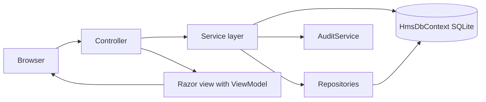

# Design: Healthcare Management System

## Overview

The Healthcare Management System (HMS) is a server-rendered ASP.NET Core MVC web application that runs on one computer with a local SQLite database. It gives a hospital four kinds of signed-in people — Admin, Doctor, Receptionist and Patient — each with its own dashboard and its own permitted modules: patients, doctors, staff and departments, appointments, consultations and medical records, prescriptions, laboratory tests, pharmacy stock, billing and payments, reports, notifications and an audit trail.

The app starts at `/`. A person who is not signed in sees the sign-in page there; a signed-in person is sent to the dashboard of their role: `/Dashboard/Admin`, `/Dashboard/Doctor`, `/Dashboard/Receptionist` or `/Dashboard/Patient`.

Everything is local: no cloud hosting, no deployment, no external database server, no email and no SMS. Notifications are rows in the database shown inside the app.

## Architecture

- **ASP.NET Core MVC (.NET 8)** with controllers, Razor views and strongly typed ViewModels. Every page is rendered on the server; JavaScript adds the interactive parts (charts, sidebar toggle, notification panel, confirmation dialogs, slot loading).
- **ASP.NET Core Identity** with `ApplicationUser : IdentityUser` and four roles: `Admin`, `Doctor`, `Receptionist`, `Patient`. Sign-in, sign-out, password change, forgot/reset password and profile pages are Identity-backed.
- **Entity Framework Core** with the SQLite provider, code-first migrations, one `HmsDbContext : IdentityDbContext<ApplicationUser>`.
- **Service layer** (`Services/`) holds the business rules: slot availability, appointment status transitions, invoice totals, stock status, notifications and audit entries. Controllers call services and never compute business rules themselves.
- **Repositories** (`Repositories/`) wrap the read queries that several pages share (patient search, appointment lists, report aggregates).
- **Dependency Injection** registers the DbContext, Identity, services and repositories in `Program.cs`.
- **Authorization** by role on every controller and action (`[Authorize(Roles = "Admin")]`), plus ownership checks in services for Patient and Doctor pages.
- **Anti-forgery** tokens on every form (`asp-antiforgery="true"` is the default for tag helpers); **server-side validation** with data annotations and custom validators; **client-side validation** with jQuery unobtrusive validation.
- **Centralized exception handling** middleware (`Middleware/ExceptionHandlingMiddleware.cs`) logs the error and shows a friendly error page without stack traces.
- **Logging** with the built-in `ILogger` to the console and a rolling file under `logs/`.
- **Audit trail** written by `AuditService` from the services that change medical and financial records.

### Request flow



## Components and Interfaces

### Controllers and their routes

Every route below is a GET unless the method says otherwise. All of them are inside the shared layout and require sign-in; the role column is the role the action requires.

| Controller | Action and route | Method | Role | Purpose |
|---|---|---|---|---|
| `AccountController` | `/Account/Login` | GET, POST | anonymous | Sign-in page at `/`; POST signs in and redirects by role |
| | `/Account/Logout` | POST | any | Ends the session, returns to `/` |
| | `/Account/ForgotPassword` | GET, POST | anonymous | Shows the reset link on the page |
| | `/Account/ResetPassword` | GET, POST | anonymous | Sets a new password from the link |
| | `/Account/Profile` | GET, POST | any | Shows user name, email, role, phone; saves phone |
| | `/Account/ChangePassword` | GET, POST | any | Changes the password |
| | `/Account/AccessDenied` | GET | any | Shows "You do not have access to this page." |
| `DashboardController` | `/Dashboard/Admin` | GET | Admin | Admin dashboard |
| | `/Dashboard/Doctor` | GET | Doctor | Doctor dashboard |
| | `/Dashboard/Receptionist` | GET | Receptionist | Receptionist dashboard |
| | `/Dashboard/Patient` | GET | Patient | Patient dashboard |
| `DepartmentController` | `/Department/Index` | GET | Admin | Department list |
| | `/Department/Create` | GET, POST | Admin | Create a department |
| | `/Department/Deactivate/{id}` | POST | Admin | Set status Inactive |
| `StaffController` | `/Staff/Index` | GET | Admin | Staff list |
| | `/Staff/Create` | GET, POST | Admin | Create a staff member |
| | `/Staff/Deactivate/{id}` | POST | Admin | Set status Inactive |
| `DoctorController` | `/Doctor/Index` | GET | Admin | Doctor list with department filter |
| | `/Doctor/Create` | GET, POST | Admin | Register a doctor and its sign-in account |
| | `/Doctor/Edit/{id}` | GET, POST | Admin | Edit details, fee and schedule |
| | `/Doctor/Details/{id}` | GET | Admin | Profile, schedule, appointment history |
| | `/Doctor/Deactivate/{id}` | POST | Admin | Set status Inactive |
| `PatientController` | `/Patient/Index` | GET | Receptionist, Admin | Patient list, search, paging |
| | `/Patient/Create` | GET, POST | Receptionist | Register a patient and its account |
| | `/Patient/Details/{id}` | GET | Receptionist, Admin, Doctor (own patients) | Profile and history |
| | `/Patient/Edit/{id}` | GET, POST | Receptionist | Edit contact and emergency details |
| | `/Patient/Deactivate/{id}` | POST | Receptionist | Set status Inactive |
| `AppointmentController` | `/Appointment/Index` | GET | Receptionist, Admin | Appointment list with status filter |
| | `/Appointment/Book` | GET, POST | Receptionist, Patient | Booking page |
| | `/Appointment/Slots` | GET (JSON) | Receptionist, Patient | Free slots for a doctor and date |
| | `/Appointment/Confirm/{id}` | POST | Receptionist | Pending to Confirmed |
| | `/Appointment/CheckIn/{id}` | POST | Receptionist | Confirmed to Checked In |
| | `/Appointment/NoShow/{id}` | POST | Receptionist | Confirmed to No Show |
| | `/Appointment/Cancel/{id}` | POST | Receptionist, Patient (own) | Cancel and free the slot |
| | `/Appointment/Start/{id}` | POST | Doctor | Checked In to In Progress, opens consultation |
| | `/Appointment/Complete/{id}` | POST | Doctor | In Progress to Completed |
| `ConsultationController` | `/Consultation/Index/{appointmentId}` | GET | Doctor | Consultation page with history |
| | `/Consultation/Save` | POST | Doctor | Create or update the Draft medical record |
| | `/Consultation/Finalize/{id}` | POST | Doctor | Draft to Final |
| `MedicalRecordController` | `/MedicalRecord/Index/{patientId}` | GET | Doctor, Patient (own), Admin | Records of a patient |
| | `/MedicalRecord/Details/{id}` | GET | Doctor, Patient (own), Admin | One record |
| `PrescriptionController` | `/Prescription/Index/{patientId}` | GET | Doctor, Patient (own) | Prescription history |
| | `/Prescription/Create/{appointmentId}` | GET, POST | Doctor | Create a prescription |
| | `/Prescription/Print/{id}` | GET | Doctor, Patient (own) | Printable page |
| | `/Prescription/SetStatus/{id}` | POST | Doctor | Completed or Cancelled |
| `LabTestController` | `/LabTest/Index` | GET | Admin | Laboratory test catalog |
| | `/LabTest/Create` | GET, POST | Admin | Add a test |
| `LabRequestController` | `/LabRequest/Index` | GET | Receptionist, Admin | Request list with status filter |
| | `/LabRequest/Create` | POST | Doctor | Request tests during a consultation |
| | `/LabRequest/Start/{id}` | POST | Receptionist, Admin | Requested to In Progress |
| | `/LabRequest/Complete/{id}` | GET, POST | Receptionist, Admin | Enter result and remarks |
| | `/LabRequest/Details/{id}` | GET | Doctor (own), Patient (own), Admin | Result view |
| | `/LabRequest/Print/{id}` | GET | Doctor (own), Patient (own) | Printable report |
| `MedicineController` | `/Medicine/Index` | GET | Admin | Medicine list and inventory report |
| | `/Medicine/Create` | GET, POST | Admin | Add a medicine |
| | `/Medicine/StockIn/{id}` | GET, POST | Admin | Record a stock-in batch |
| | `/Medicine/StockOut/{id}` | GET, POST | Admin | Record a stock-out |
| | `/Medicine/Category` | GET, POST | Admin | Medicine categories |
| | `/Medicine/Supplier` | GET, POST | Admin | Suppliers |
| `InvoiceController` | `/Invoice/Index` | GET | Receptionist, Admin | Invoice list with status filter |
| | `/Invoice/Generate/{appointmentId}` | GET, POST | Receptionist | Generate an invoice from an appointment |
| | `/Invoice/Details/{id}` | GET | Receptionist, Admin, Patient (own) | Invoice with payments |
| | `/Invoice/Print/{id}` | GET | Receptionist, Admin, Patient (own) | Printable invoice |
| | `/Invoice/Pay/{id}` | POST | Receptionist | Record a payment |
| | `/Invoice/Refund/{paymentId}` | POST | Receptionist | Refund a payment |
| `ReportController` | `/Report/Index` | GET | Admin | Reports page with date range |
| | `/Report/Patients` | GET | Admin | Patient registration report |
| | `/Report/Appointments` | GET | Admin | Appointment report |
| | `/Report/Departments` | GET | Admin | Department report |
| | `/Report/Doctors` | GET | Admin | Doctor performance report |
| | `/Report/Laboratory` | GET | Admin | Laboratory report |
| | `/Report/Pharmacy` | GET | Admin | Pharmacy stock report |
| | `/Report/Revenue` | GET | Admin | Revenue report with chart |
| `AuditController` | `/Audit/Index` | GET | Admin | Audit trail with filters |
| `NotificationController` | `/Notification/Panel` | GET (partial) | any | 10 most recent notifications, marks them read |
| | `/Notification/UnreadCount` | GET (JSON) | any | Unread count for the bell |

### JSON contract: free slots

`GET /Appointment/Slots?doctorId={int}&date={yyyy-MM-dd}` answers `200` with:

```json
{ "slots": [ { "time": "09:00", "available": true }, { "time": "09:30", "available": false } ] }
```

`time` is `HH:mm` in 30-minute steps inside the doctor's working hours for that weekday. `available` is `false` when an appointment with that doctor in status Pending, Confirmed, Checked In or In Progress starts at that time. An unknown doctor or a day the doctor does not work answers `{ "slots": [] }`.

### JSON contract: unread notifications

`GET /Notification/UnreadCount` answers `200` with `{ "count": 3 }`.

### Shared view components and partials

- `_Layout.cshtml` — sidebar, top bar (hospital name, search box, bell, profile dropdown), breadcrumb, footer.
- `_Sidebar.cshtml` — the menu items of the signed-in role.
- `_NotificationPanel.cshtml` — the bell panel.
- `_Pagination.cshtml`, `_StatusBadge.cshtml`, `_EmptyState.cshtml`, `_ConfirmDialog.cshtml`, `_KpiCard.cshtml`, `_SearchBox.cshtml` — reusable partials every list page uses.
- `_PrintLayout.cshtml` — a bare layout for the printable prescription, lab report and invoice pages.

### Services

| Service | Responsibility |
|---|---|
| `AppointmentService` | Free slots, booking with conflict check, status transitions, ownership checks |
| `ConsultationService` | Medical record create/update/finalize, patient history |
| `PrescriptionService` | Prescription lines, status changes |
| `LabService` | Lab requests, status changes, results |
| `PharmacyService` | Stock-in, stock-out, stock status (In Stock, Low Stock, Out of Stock, Expired) |
| `BillingService` | Invoice generation from an appointment, totals, payments, refunds, status |
| `ReportService` | Aggregates for the dashboard and report pages |
| `NotificationService` | Add a notification, list, mark read, unread count |
| `AuditService` | Write audit entries for medical and financial changes |
| `PatientService` | Patient ID sequence, search, registration with its account |
| `DemoDataSeeder` | Creates the demo records and demo logins on an empty database |

## Data Models

All entities carry `CreatedAt` and `UpdatedAt` (`DateTime`, UTC). Money fields are `decimal(18,2)`; the currency is the Indian rupee, shown as `₹` with 2 decimals.

| Entity | Key fields | Relationships |
|---|---|---|
| `ApplicationUser` | `Id`, `UserName`, `Email`, `PhoneNumber`, `FullName`, `IsActive` | one `Patient` or `Doctor` or `Staff` profile |
| `Patient` | `Id`, `PatientCode` (`P-00001`, unique), `FullName`, `DateOfBirth`, `Gender`, `Phone`, `Email`, `Address`, `EmergencyContactName`, `EmergencyContactPhone`, `MedicalHistory`, `Allergies`, `Status` (Active/Inactive), `UserId` | 1–1 `ApplicationUser`; 1–many `Appointment`, `MedicalRecord`, `Prescription`, `LabRequest`, `Invoice` |
| `Doctor` | `Id`, `FullName`, `Email`, `Phone`, `Specialization`, `DepartmentId`, `Qualifications`, `YearsOfExperience`, `ConsultationFee`, `Status`, `UserId` | many–1 `Department`; 1–many `DoctorSchedule`, `Appointment` |
| `DoctorSchedule` | `Id`, `DoctorId`, `DayOfWeek`, `IsWorking`, `StartTime`, `EndTime` | many–1 `Doctor`; unique (`DoctorId`, `DayOfWeek`) |
| `Staff` | `Id`, `FullName`, `Email`, `Phone`, `Role`, `Designation`, `DepartmentId`, `Status`, `UserId` | many–1 `Department` |
| `Department` | `Id`, `Name` (unique), `Status` | 1–many `Doctor`, `Staff` |
| `Appointment` | `Id`, `PatientId`, `DoctorId`, `AppointmentDate` (date), `StartTime` (time), `Status`, `Notes` | many–1 `Patient`, `Doctor`; 1–1 `MedicalRecord`; 1–1 `Invoice`; 1–many `LabRequest` |
| `MedicalRecord` | `Id`, `AppointmentId` (unique), `PatientId`, `DoctorId`, `Symptoms`, `Diagnosis`, `BloodPressure`, `Temperature`, `Pulse`, `Weight`, `TreatmentPlan`, `Observations`, `FollowUpRecommendations`, `Status` (Draft/Final) | 1–1 `Appointment`; 1–many `Prescription` |
| `Prescription` | `Id`, `PatientId`, `DoctorId`, `MedicalRecordId`, `Status` (Active/Completed/Cancelled), `Notes` | 1–many `PrescriptionItem` |
| `PrescriptionItem` | `Id`, `PrescriptionId`, `MedicineId`, `Dosage`, `Frequency`, `DurationDays`, `Instructions` | many–1 `Prescription`, `Medicine` |
| `MedicineCategory` | `Id`, `Name` (unique) | 1–many `Medicine` |
| `Supplier` | `Id`, `Name` (unique), `Phone`, `Email` | 1–many `Medicine` |
| `Medicine` | `Id`, `Name`, `CategoryId`, `SupplierId`, `UnitPrice`, `ReorderLevel`, `StockQuantity`, `Status` | 1–many `MedicineBatch`, `PrescriptionItem` |
| `MedicineBatch` | `Id`, `MedicineId`, `BatchNumber`, `Quantity`, `ExpiryDate` | many–1 `Medicine` |
| `LaboratoryTest` | `Id`, `Name`, `Category`, `Price`, `NormalRange` | 1–many `LabRequest` |
| `LabRequest` | `Id`, `PatientId`, `DoctorId`, `AppointmentId`, `LaboratoryTestId`, `Status` (Requested/In Progress/Completed/Cancelled), `ResultValue`, `Remarks`, `ResultEnteredAt` | many–1 `Patient`, `Doctor`, `Appointment`, `LaboratoryTest` |
| `Invoice` | `Id`, `InvoiceNumber` (unique), `PatientId`, `AppointmentId` (unique), `DiscountAmount`, `TaxRate`, `Total`, `PaidAmount`, `Status` (Unpaid/Partially Paid/Paid/Cancelled) | 1–many `InvoiceItem`, `Payment` |
| `InvoiceItem` | `Id`, `InvoiceId`, `Description`, `Amount` | many–1 `Invoice` |
| `Payment` | `Id`, `InvoiceId`, `Amount`, `Method` (Cash/Card/UPI/Bank Transfer), `PaidAt`, `Status` (Recorded/Refunded) | many–1 `Invoice` |
| `Notification` | `Id`, `UserId`, `Message`, `IsRead`, `CreatedAt` | many–1 `ApplicationUser` |
| `AuditEntry` | `Id`, `RecordType`, `RecordId`, `FieldName`, `OldValue`, `NewValue`, `UserName`, `ChangedAt` | none |
| `SystemSetting` | `Id`, `Key` (unique), `Value` | none |

Deletion behaviour: `Restrict` on `Appointment` → `Patient`/`Doctor`, on `Invoice` → `Appointment`, and on `MedicalRecord` → `Appointment`; `Cascade` on `PrescriptionItem` → `Prescription`, `InvoiceItem` → `Invoice`, `Payment` → `Invoice`, `DoctorSchedule` → `Doctor`, `MedicineBatch` → `Medicine`. Records are deactivated, never deleted, so history stays.

Indexes: `Patient.PatientCode` unique, `Department.Name` unique, `Invoice.InvoiceNumber` unique, `Appointment(DoctorId, AppointmentDate, StartTime)`, `Notification(UserId, IsRead)`, `AuditEntry(RecordType, ChangedAt)`.

### Invoice totals

`linesTotal = sum of InvoiceItem.Amount`; `taxable = linesTotal - DiscountAmount`; `tax = taxable * TaxRate / 100`; `Total = round(taxable + tax, 2)`; `Outstanding = Total - PaidAmount`. Status: `Paid` when `PaidAmount >= Total`, `Partially Paid` when `0 < PaidAmount < Total`, `Unpaid` when `PaidAmount = 0`.

### Appointment status transitions

`Pending → Confirmed → Checked In → In Progress → Completed`; `Pending|Confirmed → Cancelled`; `Confirmed → No Show`. Any other transition is rejected by `AppointmentService` and leaves the status unchanged. A slot is taken while its appointment is Pending, Confirmed, Checked In or In Progress; Cancelled, No Show and Completed free it.

## Error Handling

- Validation errors return the same view with the field message beside the field and the typed values kept (Requirement 17.6).
- Business rule failures return the page with a red alert carrying the exact message the requirements name ("This time slot is already booked.", "Not enough stock available.", "Payment cannot be more than the outstanding balance.", and so on).
- Successes show a green alert with the exact message the requirements name ("Appointment booked.", "Patient details saved.", "Medical record finalized.", "Your password has been changed.").
- Unauthorized role access redirects to `/Account/AccessDenied`, which shows "You do not have access to this page." and keeps the person signed in.
- A deactivated account is blocked at sign-in with "Your account is deactivated."
- Unhandled exceptions are logged and shown on `/Home/Error` with a generic message and no stack trace.

## Testing Strategy

- **xUnit** unit and integration tests in `tests/Hms.Tests/`. Integration tests use `WebApplicationFactory<Program>` with a SQLite database file in a temporary folder, created by the test setup, migrated at start and deleted at the end, so no test needs a running app or a database someone started.
- Each service rule (slots, transitions, invoice totals, stock status, audit) has unit tests; each controller page has integration tests that sign in as the right role and check the rendered HTML and the database.
- **Playwright** end-to-end journeys are saved by the Tester in `e2e/` and run only through `run_journeys`; the xUnit project excludes `e2e/`.

## Build and run
Install: dotnet restore
Test: dotnet test
Run locally: yes
Dev: dotnet run --project src/Hms.Web --urls http://127.0.0.1:%PORT%
Port variable: PORT
Health path: /health
Devices: both
Deploy: none

`Dev` runs the app on `127.0.0.1` at the port Greenfield sets in `PORT`, and the app applies the EF Core migrations and seeds the demo records when the database is empty before it starts serving. `/health` answers `200` with `{"status":"ok"}`.

## Test logins

| Role | User name | Password |
|---|---|---|
| Admin | admin@hms.local | Admin@123 |
| Doctor | dr.arjun@hms.local | Doctor@123 |
| Receptionist | reception@hms.local | Reception@123 |
| Patient | patient.ravi@hms.local | Patient@123 |

The seed script creates these only when the database holds no records, and never when `ASPNETCORE_ENVIRONMENT` is `Production`.

## Look and feel

A clean, modern healthcare SaaS style: calm navy and teal on white, generous white space, rounded cards with soft shadows, one icon set (Bootstrap Icons) and one font (Inter, with a system sans-serif fallback).

**Colours** (CSS variables in `wwwroot/css/site.css`):

- `--hms-bg: #f4f6fa` (page background, soft grey)
- `--hms-surface: #ffffff` (cards, tables, sidebar)
- `--hms-text: #1b2437` (primary text), `--hms-text-muted: #64708a`
- `--hms-primary: #0f2f5c` (navy, sidebar and headings), `--hms-primary-hover: #16407a`
- `--hms-accent: #0f9d94` (teal, main actions and active states), `--hms-accent-hover: #0b7f78`
- `--hms-error: #d64545`, `--hms-success: #1f9d55`, `--hms-warning: #d98a1f`
- `--hms-border: #e2e7f0`

**Type and spacing:** Inter 14px base, 24px page titles, 13px table text; spacing scale 4/8/12/16/24/32px; corner radius 12px on cards, 8px on buttons and fields; shadow `0 1px 2px rgba(16,24,40,.06), 0 4px 12px rgba(16,24,40,.06)`.

**Components:**

- Buttons: primary teal filled, secondary white with navy border, danger red; hover darkens, focus shows a 2px teal ring, pressed moves down 1px, disabled is 50% opacity with no pointer.
- Fields: white with `--hms-border` border, 8px radius, label above in 13px muted text; focus border teal with a soft ring; invalid border red with the message below in red.
- Tables: white card, header row in soft grey uppercase 12px, row hover `#f8fafc`, status badges as rounded pills (Pending amber, Confirmed blue, Checked In teal, In Progress navy, Completed green, Cancelled grey, No Show red; Unpaid red, Partially Paid amber, Paid green).
- KPI cards: icon in a tinted circle, big number, label, small trend line.
- Sidebar: navy, white icons and labels, active item with a teal left bar; collapsed to 72px of icons.

**Layout per screen:**

- **Sign-in, forgot and reset password:** a centred card on a navy-to-teal gradient with the hospital name and logo above the fields; on a phone the card fills the width with 16px margins.
- **Dashboards (Admin, Doctor, Receptionist, Patient):** a row of 4 KPI cards (2×2 on a phone), then charts and recent-activity cards in a 2-column grid on desktop, stacked on a phone; quick-action buttons at the top right on desktop, full width on a phone.
- **List pages (patients, doctors, staff, departments, appointments, lab requests, medicines, invoices, audit):** a page header with title and primary action, a toolbar with search box, sort control and status filter, a table on desktop and stacked cards on a phone, pagination at the bottom, "No records found." when empty.
- **Forms (patient, doctor, staff, department, medicine, consultation, prescription, invoice):** a two-column field grid on desktop, one column on a phone, grouped in titled cards, actions at the bottom right.
- **Printable pages (prescription, lab report, invoice):** a white A4-style sheet with the hospital name and logo at the top, the details in a bordered table, and a Print button that is hidden when printing.

## Where the parts meet

- **Layout and shared partials** are written by Project setup in `Views/Shared/` and `wwwroot/css/site.css`; every screen task uses them and adds only its own view and its own stylesheet under `wwwroot/css/pages/`.
- **Navigation:** Project setup writes `Views/Shared/_Sidebar.cshtml` with every menu item of every role, each pointing at the route in the table above, so no screen task changes it.
- **Routes:** every controller and action in the table above is created by Project setup, with its role attribute and a working page; screen tasks fill in the views and services of their own controllers only.
- **Notifications:** `NotificationService.Add(userId, message)` is the one way a notification is created; the bell reads `GET /Notification/UnreadCount` and `GET /Notification/Panel`.
- **Audit:** `AuditService.Record(recordType, recordId, field, oldValue, newValue, userName)` is called by the services that change medical and financial records.
- **Demo data:** `DemoDataSeeder` runs from `Program.cs` after the migrations, only when the database is empty.

## Assumptions

- The app is one ASP.NET Core MVC project, `src/Hms.Web`, with the test project `tests/Hms.Tests`; the solution file is `Hms.sln`.
- The hospital name shown in the layout and on printable pages is "Greenfield General Hospital", stored in `SystemSetting` and editable by the Admin.
- The app targets .NET 8, the current long-term-support release of ASP.NET Core.
- Charts are drawn with Chart.js loaded from `wwwroot/lib/chart.js`, so the app needs no internet connection.
- The demo doctor's working hours are Monday to Saturday, 09:00 to 17:00, and the demo appointments fall inside them.
