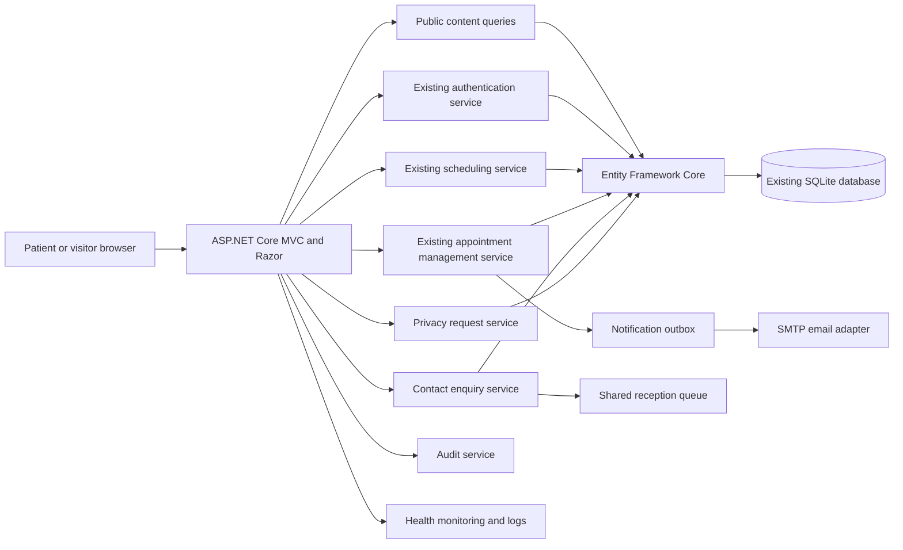

# Design: Premium Hospital Website – Healthcare Management System

## Overview

The application is an ASP.NET Core MVC website that places the public hospital experience at `/`. It uses Razor views, Bootstrap 5, custom CSS, and small JavaScript modules for responsive navigation, filtering, validation, and the stepped Appointment Booking journey. Entity Framework Core continues to use the existing SQLite database, and application services adapt public requests to the existing authentication, scheduling, appointment, billing, pharmacy, laboratory, medical-record, and audit behavior rather than duplicating those rules.

The design has four boundaries:

1. **Public presentation:** discoverable public pages for hospital information, Departments, Doctors, Medical Services, Health Packages, articles, Emergency Care, Contact Us, Patient Login, Registration, and Appointment Booking.
2. **Application services:** public-query, scheduling, appointment, contact, authentication, privacy, notification, reporting, audit, and operational-review services that enforce use cases and authorization.
3. **Existing domain and persistence:** the existing models, workflows, Entity Framework Core `DbContext`, SQLite schema, and protected healthcare records remain the system of record.
4. **Operational adapters:** SMTP email, the shared reception queue, monitoring, audit storage, Azure persistent storage, and backup operations sit behind interfaces so tests can use deterministic local substitutes.

The public website renders complete HTML on the server. JavaScript progressively enhances filters and Appointment Booking; every form still has a normal server submission path, antiforgery validation, server-side validation, and an accessible error summary.

## Architecture



### Solution layout

The implementation uses a single deployable web application and separate test projects:

```text
HospitalWebsiteManagement.sln
src/
  Hospital.Web/
    Controllers/
    ViewModels/
    Views/
    wwwroot/css/
    wwwroot/js/
    Program.cs
    appsettings.json
    appsettings.Development.json
  Hospital.Application/
    Contracts/
    Services/
    Validation/
  Hospital.Domain/
    Models/
    Rules/
  Hospital.Infrastructure/
    Data/
    Identity/
    Messaging/
    Monitoring/
tests/
  Hospital.UnitTests/
  Hospital.IntegrationTests/
  Hospital.ArchitectureTests/
e2e/
```

- `Hospital.Web` owns routes, Razor views, browser-facing view models, static assets, security middleware, and dependency registration.
- `Hospital.Application` coordinates use cases through interfaces and returns result types that distinguish validation, conflict, unavailable-service, not-found, forbidden, and successful outcomes.
- `Hospital.Domain` retains domain records and rules that already exist. New public presentation code must not move scheduling, billing, clinical, or authentication decisions into controllers or JavaScript.
- `Hospital.Infrastructure` keeps the existing Entity Framework Core mappings and SQLite schema, and implements email, queue, audit, health, and monitoring adapters.
- Integration tests use a temporary copy of a representative SQLite database, apply migrations, start the ASP.NET Core application in-process on an operating-system-selected port, and remove the database afterward.

### Request pipeline

Middleware runs in this order: forwarded headers, HTTPS redirection outside local tests, static files with cache headers, routing, authentication, authorization, antiforgery protection for unsafe form actions, request correlation, exception handling, and endpoint mapping. Security headers include a restrictive Content Security Policy, `X-Content-Type-Options: nosniff`, `Referrer-Policy: strict-origin-when-cross-origin`, and frame restrictions. The CSP permits only the application's own scripts and styles plus explicitly configured image and map origins.

Public controllers request only public projection types. Protected entities are never serialized into public view models. A global fallback authorization policy protects routes unless their controller or action is explicitly marked public; this prevents a new protected controller from becoming public by omission.

## Components and Interfaces

### Public page composition

`HomeController` composes the homepage from `IPublicHospitalQueryService`. It requests published hospital details, featured Departments, Doctors, Medical Services, Health Packages, approved Patient Testimonials, and latest published Health Articles in one read operation. Missing optional sections render as absent sections, while the core hospital contact and emergency values use maintained fallback configuration.

`AboutController`, `DepartmentsController`, `DoctorsController`, `MedicalServicesController`, `HealthPackagesController`, `ArticlesController`, and `EmergencyCareController` expose read-only public routes. Their query services project only published fields. Detail requests return either a public projection or a not-found result; a draft, archived, withdrawn, or otherwise unavailable record is indistinguishable from a nonexistent record to a public visitor.

### Appointment Booking orchestration

`AppointmentController` owns the server-rendered Appointment Booking page and submission. `AppointmentBookingService` coordinates these existing boundaries:

- `IPublicHospitalQueryService` supplies published Departments and Doctors.
- `ISchedulingService` remains the sole source of doctor availability and available time slots.
- `IAppointmentManagementService` validates and creates the Appointment and decides its immediate status.
- `IAuthenticationService` identifies a signed-in Patient when present, without requiring a public visitor to enter a protected area before starting.
- `INotificationOutbox` records confirmation and reminder messages in the same successful transaction as the workflow result where the existing schema supports it; otherwise it uses an idempotent outbox write immediately after the Appointment transaction.
- `IBookingAnalytics` records booking visits, starts, validation failures, and accepted submissions without storing clinical content.

The browser keeps the current booking state in the page and posts the complete command at submission. The server never trusts department, doctor, slot, status, or Patient identity supplied by the browser. It reloads the Doctor and slot through existing services, verifies the slot belongs to that Doctor and date, and invokes the existing appointment workflow once. A per-submission idempotency key prevents a retry from creating a duplicate Appointment.

### Contact and shared reception queue

`ContactController` validates a Contact enquiry and passes it to `IContactEnquiryService`. That service creates one Contact enquiry and one shared-queue item transactionally. `IReceptionQueue` owns New, Assigned, Answered, Closed, and overdue state. A hosted job marks an unhandled enquiry overdue after one business day and records one escalation marker, so repeated job runs do not create duplicate alerts.

### Authentication and patient continuity

The existing ASP.NET Core authentication scheme and password policy remain authoritative. Public Registration and Patient Login use dedicated view models and the existing authentication service. Login accepts an email address or patient identifier and always returns the same invalid-credentials message. Return URLs are allowed only when local to the application. Appointment Booking stores only a short-lived server-side continuation token, not personal or medical details in a query string; successful Registration or Patient Login consumes that token and returns the Patient to the same booking step.

### Privacy, authorization, and audit

Authorization policies map existing roles and permissions to named policies such as `PatientArea`, `ManageAppointments`, `ManagePublicContent`, `ManagePrivacyRequests`, and `ViewOperationalReports`. Public endpoints have no access to protected repositories.

`IPrivacyRequestService` records access, correction, and deletion requests, identity verification, affected record categories, retention decisions, completion outcome, time, and responsible Admin. Deletion is implemented as deletion or anonymization only after the existing retention policy evaluates every linked record. Immutable audit entries record protected views and changes, public emergency-information changes, access decisions, and privacy outcomes. Application code exposes no update or delete operation for ordinary users against the audit store.

Support diagnostics use redacted operational projections containing service state, request identifiers, queue age, log references, and account status. They do not include appointment notes, medical content, billing details, or a user-impersonation operation.

### Notifications, jobs, and operational review

Hosted services process the durable notification outbox, 24-hour Appointment reminders, one-business-day Contact enquiry escalations, and monthly review entries for public doctor availability and Emergency Care information. Every job uses a stable occurrence key, for example `appointment-reminder:{appointmentId}:{dueDate}`, so retries are idempotent. Failures remain pending with attempt count, next-attempt time, and correlation ID, and raise monitoring alerts after the configured threshold.

Email is sent through an `IEmailSender` SMTP adapter. Local development uses Mailpit. Automated tests replace it with an in-memory capture adapter. Production receives SMTP credentials through Azure App Service settings; credentials are never stored in source control or SQLite.

### Reporting and measurement

`IReportingService` builds:

- the Appointment booking funnel from anonymous visit/start/validation/submission events and an optional staff-help marker;
- Appointment demand and slot counts grouped by Department and Doctor for a selected period; and
- Contact enquiry queue counts grouped by New, Assigned, Overdue, Answered, and Closed.

Analytics uses a generated journey ID rather than health or free-text data. Retention and access follow the hospital privacy policy. The 90-day success measure is `valid requests submitted without staff help / booking starts`, with a zero-start period reported as no result rather than 0%.

## Public Routes and Screens

### Shared shell

All public screens use `_PublicLayout.cshtml`, a skip link, landmark elements, hospital wordmark, responsive navigation, Emergency Care route, prominent Book an Appointment action, and footer. Desktop navigation shows the primary links and grouped dropdowns for Departments, Doctors, and Medical Services. Tablet and phone navigation uses an accessible off-canvas menu with focus trapping, Escape-to-close, a visible close control, and restored focus.

`/` opens the public homepage for every unauthenticated person. A Patient who signs in outside Appointment Booking opens `/patient`; a Patient who signs in during booking returns to the stored Appointment Booking step.

### Home `/`

The desktop hero uses a two-column composition with copy and actions on the left and hospital imagery on the right. On phones it becomes a single column with the headline and Book Appointment action before the image. The following sections use alternating editorial bands and responsive cards: About Our Hospital, Our Specialties, Our Doctors, Our Medical Services, Why Choose Us, Appointment, Health Packages, Patient Testimonials, Latest Health Articles, and Contact. The footer carries useful links, Departments, Medical Services, contact information, Emergency Care, and social links.

### About Us `/about`

An editorial hero introduces the hospital. Experience and achievements appear as concise statistic cards, followed by quality-of-care content and hospital imagery. Routes to Departments, Our Doctors, Medical Services, and Book an Appointment remain visible. Phone layouts stack media and text in reading order.

### Departments `/departments` and `/departments/{slug}`

The index presents published Department cards in a responsive grid with image, name, short description, and detail action. Department Details uses a wide identity header, descriptive content, related published Doctors, and a Book an Appointment action preselecting the Department. An unavailable slug renders the public 404 presentation with a route back to Departments.

### Our Doctors `/doctors` and `/doctors/{slug}`

The index provides Department and specialization filters above profile cards. Filters submit through query parameters and are progressively enhanced without changing their URL semantics. Each card shows photo, name, qualifications, specialization, Department, and detail action. Doctor Details places the professional profile beside qualifications and Department information, then an availability panel and Book an Appointment action preselecting the Doctor. Availability has loading, available, no-slots, unavailable-service, and retry states announced through an ARIA live region.

### Medical Services `/medical-services` and `/medical-services/{slug}`

The index uses image-led cards with name and description. Service Details uses an editorial hero, public service content, relevant care information, and a Book an Appointment action. An unavailable slug returns the public 404 presentation.

### Health Packages `/health-packages` and `/health-packages/{slug}`

Cards and detail panels show package name, description, and public package details as information. They contain no purchase, booking, checkout, invoice, card, tax, charge, or refund control. An unavailable package returns the public 404 presentation.

### Appointment Booking `/appointments/book`

The screen uses one clear stepper: Department, Doctor, Availability, Appointment Date, Time Slot, Personal Information, and Confirmation. Desktop places the step content beside a sticky non-sensitive selection summary. Phone uses a single column with the current step first and a collapsible summary. Doctor choices are visual cards, dates use an accessible date control, and time slots use radio-button cards rather than a generic dropdown. Back preserves completed choices; changing Department clears Doctor, date, and slot; changing Doctor clears date and slot; changing date clears slot.

The final review names the selected Department, Doctor, date, slot, and personal information before submission. The submit button disables only while one request is in flight. Validation appears in a summary and beside each field. Confirmation shows the existing workflow's immediate status and existing Patient Appointment actions. Slot conflict and service failure remain on the journey with explicit retry or choose-another-slot actions.

### Contact Us `/contact`

Desktop uses a contact-information and map column beside the form; phone stacks the emergency route, contact methods, map, then form. The form has contact name, email, phone, subject, and message fields, a consent acknowledgement where required, field errors, submission progress, success confirmation, and retry state. The success state never reveals queue or staff details.

### Patient Login `/patient/login` and Registration `/patient/register`

Both screens use a focused card within the public layout, not a management-style shell. Patient Login accepts email address or patient identifier and password, with a password reveal control whose accessible name changes with state. Registration renders the account and personal fields required by the existing authentication service. Both show error summaries, preserve safe entered values, exclude password values on redisplay, and provide links between the two journeys.

### Emergency Care `/emergency-care`

The screen places the emergency phone number, immediate-life-threatening-emergency statement, contact instructions, and location instructions above other content. A persistent public header/footer route reaches it from every public screen. If current content cannot load, the application renders fallback phone and location values from configuration.

### Patient area and public errors

`/patient` is the secured landing screen after Patient Login and links to the existing Patient Appointment actions. Public 404, forbidden, validation, and service-unavailable pages use the same public branding and offer safe recovery routes without exception details or protected identifiers.

## Look and feel

### Design tokens

- Page background: `#F7FAFC`
- Surface: `#FFFFFF`
- Primary text: `#102A43`
- Muted text: `#52667A`
- Navy brand: `#0B2D4D`
- Primary teal: `#087F8C`
- Primary teal hover: `#066B76`
- Light teal accent: `#E6F6F7`
- Border: `#D7E2EA`
- Success: `#16794B`
- Error: `#B42318`
- Warning: `#A15C00`
- Focus ring: `#0A66C2`
- Font: `Inter`, with `Segoe UI`, Arial, and sans-serif fallbacks
- Type scale: 16px body, 14px supporting text, 20–24px card headings, and fluid 36–64px page heroes
- Spacing: an 8px base scale using 8, 16, 24, 32, 48, 64, and 96px intervals
- Corner radius: 12px controls, 16px cards, and 24px feature panels
- Shadow: soft navy-tinted shadows used only to separate raised cards and menus

### Shared states

Primary buttons use solid teal with white text; secondary buttons use white with navy border and text. Hover darkens the fill or raises a card by at most 2px. Pressed removes elevation and darkens one additional step. Keyboard focus uses a 3px focus ring with 2px offset. Disabled controls use reduced contrast, retain readable labels, and do not respond to pointer events. Links are underlined on hover and focus, and links embedded in paragraphs remain underlined by default.

Fields use white surfaces, persistent labels, 44px minimum target height, visible borders, explanatory help beneath the label, and error text with an icon rather than colour alone. Lists and card grids use consistent image ratios and equal internal spacing. Skeletons may be used only for asynchronous availability; they include accessible status text. Animations last 150–250ms and are removed when `prefers-reduced-motion: reduce` is active.

Professional hospital and healthcare imagery uses responsive `srcset`, explicit width and height, meaningful alternative text when informative, and empty alternative text when decorative. Hero imagery is eager-loaded; below-the-fold imagery is lazy-loaded. Content width is capped at 1200px with 24px desktop gutters and 16px phone gutters.

At widths below 768px, multi-column layouts become one column, navigation becomes off-canvas, action groups stack when needed, and cards use full available width. From 768px through 1199px, grids use two columns where content permits. At 1200px and above, editorial sections use two columns and card grids use three or four columns according to content density.

## Endpoint and Message Contracts

All JSON endpoints return UTF-8 JSON. Validation errors use RFC 7807 `application/problem+json` with `type`, `title`, `status`, `detail`, `traceId`, and an `errors` object whose keys are exact request field names. Browser forms post the same field names as their JSON equivalents and receive HTML on normal form submission. Unsafe requests require an antiforgery token. Dates use `YYYY-MM-DD`; timestamps use ISO 8601 with an offset; identifiers are opaque strings.

### Public pages

- `GET /` returns the homepage HTML with status 200.
- `GET /about`, `GET /departments`, `GET /doctors`, `GET /medical-services`, `GET /health-packages`, `GET /contact`, and `GET /emergency-care` return their public index HTML with status 200.
- `GET /departments/{slug}`, `GET /doctors/{slug}`, `GET /medical-services/{slug}`, `GET /health-packages/{slug}`, and `GET /articles/{slug}` return published detail HTML with status 200, or public not-found HTML with status 404.
- `GET /doctors?department={departmentSlug}&specialization={specialization}` returns filtered Doctor index HTML. Either query field may be absent.

### Appointment selection APIs

#### `GET /api/public/departments`

Success 200:

```json
{
  "items": [
    { "id": "opaque-id", "name": "Cardiology", "slug": "cardiology" }
  ]
}
```

#### `GET /api/public/doctors?departmentId={departmentId}`

Success 200:

```json
{
  "items": [
    {
      "id": "opaque-id",
      "name": "Doctor name",
      "slug": "doctor-name",
      "qualifications": "Qualifications",
      "specialization": "Specialization",
      "departmentId": "opaque-id",
      "photoUrl": "/media/doctors/doctor-name.webp"
    }
  ]
}
```

Errors: 400 for an invalid `departmentId`; 503 with problem type `scheduling-unavailable` when the underlying service cannot answer.

#### `GET /api/public/doctors/{doctorId}/availability?date={date}`

Success 200:

```json
{
  "doctorId": "opaque-id",
  "date": "2026-11-05",
  "timeZone": "hospital-local-time-zone",
  "slots": [
    { "slotId": "opaque-slot-token", "startsAt": "2026-11-05T09:00:00+05:30", "displayTime": "9:00 AM" }
  ]
}
```

Errors: 400 for a missing or invalid date; 404 when the Doctor is not publicly available; 503 with problem type `scheduling-unavailable` and a safe retry message when the scheduling service fails. The opaque `slotId` expires and is revalidated at submission.

### Appointment submission

#### `GET /appointments/book`

Returns Appointment Booking HTML. Optional query fields `department` and `doctor` may preselect a published Department or Doctor; invalid values are ignored rather than disclosed.

#### `POST /appointments`

Request body or form fields:

```json
{
  "departmentId": "opaque-id",
  "doctorId": "opaque-id",
  "appointmentDate": "2026-11-05",
  "slotId": "opaque-slot-token",
  "patient": {
    "fullName": "Patient name",
    "dateOfBirth": "1990-04-12",
    "email": "patient@example.test",
    "phone": "+910000000000",
    "patientIdentifier": "optional-existing-identifier"
  },
  "reasonForVisit": "Brief reason",
  "idempotencyKey": "client-generated-opaque-value"
}
```

Success 201:

```json
{
  "bookingReference": "public-reference",
  "status": "Pending",
  "confirmationMessage": "Your appointment request was submitted.",
  "appointmentActionsUrl": "/patient/appointments/public-reference"
}
```

Errors: 400 validation problem; 409 problem type `slot-no-longer-available` with `doctorId`, `appointmentDate`, and a `refreshAvailabilityUrl`; 401 with a local Patient Login continuation when the existing workflow requires authentication; 503 problem type `appointment-service-unavailable` stating that the request was not confirmed. A repeated accepted `idempotencyKey` returns the original success response and creates no second Appointment.

### Contact enquiry

#### `POST /contact`

Request body or form fields:

```json
{
  "contactName": "Visitor name",
  "email": "visitor@example.test",
  "phone": "+910000000000",
  "subject": "Enquiry subject",
  "message": "Enquiry message",
  "consentAcknowledged": true,
  "idempotencyKey": "client-generated-opaque-value"
}
```

Success 201 returns `{ "enquiryReference": "public-reference", "message": "Your enquiry was sent to reception." }`. Errors are 400 validation problem or 503 problem type `reception-queue-unavailable` stating that the enquiry was not confirmed. Repeating an accepted `idempotencyKey` does not create another Contact enquiry.

### Patient authentication

#### `POST /patient/register`

Fields are `email`, `patientIdentifier` when applicable, `password`, `confirmPassword`, `fullName`, `dateOfBirth`, `phone`, and `returnToken`. Success redirects with 303 to the validated continuation or `/patient`. Errors redisplay status 400 with field messages; an existing identifier uses the generic message and a route to Patient Login.

#### `POST /patient/login`

Fields are `identifier`, `password`, `rememberMe`, and `returnToken`. Success redirects with 303 to the validated continuation or `/patient`. Invalid credentials return status 400 and the same generic message for every credential failure. Service failure returns status 503 with a retry-later message. Rate limiting may return 429 with `Retry-After` and no account-existence disclosure.

### Privacy request

#### `POST /patient/privacy-requests`

Authenticated Patient fields are `action` with `Access`, `Correct`, or `Delete`; `details`; and `contactPreference`. Success 201 returns `requestReference`, `status: Recorded`, and `submittedAt`. Errors are 400 validation problem, 401 for no Patient session, and 503 when recording fails. Staff processing continues through the existing protected workflow and policies.

### Health and operational contracts

- `GET /health` returns 200 with `{ "status": "Healthy" }` when the web process and required database connection are healthy; it returns 503 with `{ "status": "Unhealthy", "traceId": "..." }` without exposing credentials, paths, schema, or record details.
- `BookingStarted` carries `journeyId`, `occurredAt`, and optional `departmentId`.
- `BookingValidationFailed` carries `journeyId`, `occurredAt`, and validation field names only.
- `AppointmentAccepted` carries `appointmentId`, `bookingReference`, `patientId`, `email` when supplied, `startsAt`, `status`, and `occurredAt`.
- `ContactEnquiryQueued` carries `enquiryId`, `queueItemId`, `occurredAt`, and no message body.
- `AppointmentReminderDue` carries `appointmentId`, `patientId`, `email`, `startsAt`, and occurrence key.
- `OperationalReviewDue` carries `reviewType`, `period`, `recordIds`, and occurrence key.

Events are internal durable outbox messages, not a public message bus contract. Consumers record the message ID before applying side effects so replay is safe.

## Data Models

Existing entity names and columns are retained wherever already present. Migrations may add public-presentation and operational fields but must not rename or destructively replace existing authentication, Appointment, billing, pharmacy, laboratory, or medical-record tables. Before applying a migration to production, staging applies it to a tested copy of the existing database and verifies representative counts and protected workflows.

### Public projections

- **HospitalProfile:** public introduction, experience, achievements, quality-of-care copy, address, phone, email, map coordinates, social links, fallback Emergency Care phone, and fallback location instruction.
- **Department:** existing identifier plus `Name`, `Slug`, `ImagePath`, `Description`, `Details`, `PublicationState`, `PublishedAt`, and archive metadata.
- **Doctor:** existing identifier plus `Name`, `Slug`, `PhotoPath`, `Qualifications`, `Specialization`, `DepartmentId`, public profile, publication state, and public-availability flag. Actual slots remain owned by the scheduling service.
- **MedicalService:** existing identifier plus `Name`, `Slug`, `ImagePath`, `Description`, `Details`, and publication state.
- **HealthPackage:** existing identifier plus `Name`, `Slug`, `Description`, `Details`, and publication state. It has no public checkout state.
- **PatientTestimonial:** feedback, review attribution allowed by consent, consent record reference, and Draft, Approved, Published, or Withdrawn state.
- **HealthArticle:** title, slug, summary, body, image, author attribution, published time, and Draft, Published, or Archived state.

Slugs are unique within their content type, stable after publication unless an explicit redirect is created, lowercase, and composed of ASCII letters, digits, and hyphens. Public projections never include private notes, account identifiers, medical content, billing content, or unpublished fields.

### Workflow and operational records

- **Appointment:** remains owned by the existing appointment management service and preserves Draft, Submitted, Pending or Confirmed, Completed, Cancelled, and No-show behavior. Added public fields, if absent, are `BookingReference` and `SubmissionIdempotencyKey` with unique indexes.
- **ContactEnquiry:** contact information, subject, message, New, Assigned, Answered, or Closed state, timestamps, assignee reference, public reference, and idempotency key.
- **ReceptionQueueItem:** enquiry reference, queue state, entered time, assigned time, answered time, closed time, due time, and escalation time.
- **PrivacyRequest:** Patient reference, requested action, details, submitted time, identity-verification evidence reference, affected record categories, retention decisions, outcome, completion time, and responsible Admin reference.
- **NotificationOutbox:** message ID, type, payload, occurrence key, created time, next attempt, attempt count, sent time, and last safe error code. `OccurrenceKey` is unique.
- **AuditEntry:** actor reference, action, protected record type and reference, timestamp, correlation ID, outcome, and a structured change summary that excludes secrets. Ordinary application roles receive append/read permissions only as authorized, never mutation permissions.
- **BookingAnalyticsEvent:** journey ID, event type, occurred time, Department or Doctor reference when relevant, validation field names, and staff-help marker. It excludes names, contact details, free text, and medical reasons.
- **OperationalReview:** review type, period, affected public record references, state, created time, completed time, and responsible user.

SQLite write operations that create an Appointment, queue a Contact enquiry, or write an outbox item use short transactions, unique constraints, and bounded busy retries. The connection enables foreign keys and WAL mode. Long reports use read-only projections and do not hold write transactions.

## Validation and Error Handling

- Razor view models use data annotations for browser-compatible rules and application validators for cross-field rules. The server repeats every rule and treats browser checks only as guidance.
- Validation messages state what must change and are linked to their fields. Error summaries receive focus after an invalid submission.
- Appointment validation verifies publication state, Department–Doctor relationship, date, opaque slot, Patient fields, and existing workflow rules. It does not copy scheduling rules into JavaScript.
- A global exception handler maps known result types to 400, 401, 403, 404, 409, 429, or 503 and maps unexpected exceptions to a branded 500 response with a trace ID. Stack traces and record values are never shown outside development.
- Logs use structured templates, correlation IDs, and redaction. Passwords, antiforgery tokens, cookies, health information, free-text reasons, contact messages, and full medical or billing identifiers are excluded.
- When connectivity is lost, JavaScript may show an offline notice but cannot mark a form successful. The server confirmation is the only accepted result.
- Emergency Care falls back to maintained configuration when the current record cannot be loaded. Other missing optional homepage content is omitted without breaking the page.

## Security and Privacy

- ASP.NET Core Identity-compatible password hashing, secure `HttpOnly` cookies, `SameSite=Lax`, HTTPS-only production cookies, sliding expiration limits, lockout, and the existing second verification step protect authenticated sessions.
- Antiforgery validation protects every unsafe browser action. Login, Registration, Appointment, Contact, and privacy submissions have partitioned rate limits.
- Authorization is policy-based and denied by default. Object-level checks apply after route-level checks. Public controllers depend only on public-query interfaces.
- Return URLs and media URLs are allowlisted local paths. User text is Razor encoded; rich article content is sanitized on write and rendered from an allowlisted subset.
- SQLite, backups, and Azure persistent storage use platform encryption at rest. TLS protects data in transit. Secrets are read from Azure App Service settings or local development configuration excluded from source control.
- Consent gates Patient Testimonial publication. Withdrawal removes the public projection while preserving only the required consent audit.
- Care, Appointment, billing, and audit records are retained for seven years or longer where local law requires. Deletion and anonymization preserve required referential and audit evidence.
- Backups inherit the same access restrictions and retention rules as production data. Restore tests use controlled copies and produce audit evidence.

## Performance, Capacity, and Resilience

Public content uses asynchronous EF Core no-tracking projections, bounded result sets, compiled hot queries where measurement justifies them, and short-lived output or data caching for published lists and homepage sections. Publication changes evict affected cache keys. Availability and Appointment submission are not cached beyond the scheduling service's explicit slot token lifetime.

Images use WebP or AVIF where available, responsive dimensions, compression, and lazy loading below the fold. CSS and JavaScript are bundled and minified for production; critical public-layout CSS is small and shared. Static assets use content hashes and long-lived cache headers.

Load tests model 500 simultaneous public visitors and 75 simultaneous signed-in people, including public browsing, availability reads, Appointment submissions, and existing protected workflow smoke journeys. Data-volume tests use 50,000 Patient records, 250,000 historical Appointments, 36,500 year-1 Appointments, and 55,000 year-3 Appointments. The acceptance gate is the two-second public-page 95th percentile, three-second availability 95th percentile, and five-second Appointment result 95th percentile.

SQLite remains the selected database. WAL mode, short transactions, indexes on public state/slug, schedule lookup fields, queue state/due time, outbox due time, and reporting period reduce contention. Load testing must fail the release if expected concurrent writes cannot satisfy the targets; it must not silently bypass the existing workflow.

Azure App Service health checks call `/health`. Application Insights or the configured Azure monitoring sink receives request rates, latency percentiles, failure rates, dependency health, queue age, outbox failures, and backup/restore status. Alerts route by email and monitoring console to hospital IT support without protected content.

Production uses at least two staging/production deployment environments. The SQLite database, data-protection keys, and uploaded public media use Azure persistent storage mounted outside the deployment package. Automated snapshots run often enough to limit confirmed-data loss to 15 minutes, and the documented restore procedure targets service return within 4 hours. Promotion takes an immediate pre-cutover backup, validates migrations and smoke journeys in staging, swaps or promotes the tested build, and leaves one production system of record.

## Testing Strategy

### Unit and component tests

- Application-service tests verify publication filtering, availability orchestration, Appointment command mapping, conflict handling, idempotency, queue escalation, reminder occurrence keys, retention decisions, and report calculations.
- Controller tests verify routes, status codes, local redirects, antiforgery behavior, authorization policy requirements, and safe error models.
- Razor rendering tests verify required landmarks, headings, navigation labels, field/error associations, and absence of protected fields in public HTML.
- JavaScript tests verify booking-state transitions, dependent-selection clearing, progressive enhancement, menu keyboard behavior, and in-flight submission locking.

### Integration tests

`WebApplicationFactory` starts the application in-process with a temporary SQLite database and deterministic fake email and monitoring adapters. Tests apply all migrations, seed published and unpublished content, exercise public HTML and JSON contracts, verify authorization boundaries, and inspect persisted Appointment, queue, outbox, privacy, and audit results. A compatibility fixture opens a representative copy of the existing SQLite database and verifies that migrations preserve existing accounts and healthcare records.

Concurrency tests submit the same idempotency key and compete for one slot, proving that at most one Appointment is created and every caller receives a truthful result. Job tests advance a fake clock and run reminder, escalation, and monthly review workers repeatedly to prove one effect per occurrence.

### Browser journeys

Playwright journeys run against a locally started application on desktop, tablet, and phone viewports. They cover homepage navigation, every public index/detail route, Doctor filters and availability, successful and conflicting Appointment Booking, Contact enquiry, Registration, Patient Login and continuation, Emergency Care fallback, keyboard-only navigation, reduced motion, responsive overflow, and public denial of protected routes. Automated accessibility scans complement manual checks for focus order, announcements, zoom, contrast, and screen-reader naming.

### Performance, resilience, and operations tests

A repeatable load-test project seeds target data volumes and exercises the 575-person workload while recording percentile targets. Fault-injection integration tests make scheduling, authentication, Appointment, reception queue, SMTP, and database adapters fail and verify truthful retry responses and alerts. Deployment checks validate the Azure package, startup migration strategy, mounted persistent paths, health endpoint, backup schedule, restore runbook, security headers, and absence of secrets.

## Correctness Properties

### Property P1: Only published public information is visible
For any generated mix of public records and publication states, every public list and detail result contains only records in its published state, and an unavailable identifier returns the public not-found result.
- _Validates: 2.3, 3.1, 3.2, 3.4, 3.5, 4.1, 4.2, 4.3, 4.6, 4.7, 5.1, 5.2, 5.4, 5.5, 6.1, 6.2, 6.5, 6.6_
- _Kind: invariant_

### Property P2: Public projections exclude protected data
For any generated public request and protected data set, public HTML, JSON, logs, and errors contain none of the Patient, medical record, billing, private Appointment, staff account, password, token, or free-text protected values.
- _Validates: 12.2, 12.7, 12.8_
- _Kind: invariant_

### Property P3: Appointment selections remain consistent
For any generated sequence of Department, Doctor, date, and slot changes, the current Doctor belongs to the current Department, the current slot belongs to the current Doctor and date, and changing an earlier selection clears every dependent selection.
- _Validates: 7.1, 7.2, 7.3, 7.4, 7.5_
- _Kind: transition_

### Property P4: Appointment submission is atomic and idempotent
For any valid Appointment command and any number of retries with the same idempotency key, the existing Appointment management service creates at most one Appointment and all accepted retries return the same booking reference and workflow status.
- _Validates: 7.7, 7.9, 12.4_
- _Kind: idempotence_

### Property P5: A lost slot never produces a booking
For any Appointment command whose slot becomes unavailable before submission, the result is a slot-conflict response, no new Appointment exists, and refreshed availability excludes that slot.
- _Validates: 7.8_
- _Kind: error_

### Property P6: Failed submissions never claim success
For any generated validation, connection, scheduling, Appointment-service, or reception-queue failure before acceptance, the response does not contain a confirmation and no accepted Appointment or Contact enquiry is reported.
- _Validates: 7.6, 7.10, 8.2, 8.5, 9.2, 9.7_
- _Kind: error_

### Property P7: Contact enquiry queueing is exactly once
For any valid Contact enquiry and any number of retries with one idempotency key, exactly one Contact enquiry and one New shared-queue item exist and one Receptionist new-item alert is produced.
- _Validates: 8.3, 8.4_
- _Kind: idempotence_

### Property P8: Time-based jobs produce one effect per occurrence
For any generated active Appointment, unhandled Contact enquiry, or monthly review period, repeated worker runs before and after the due time produce no early effect and exactly one reminder, escalation, or operational review item after it is due.
- _Validates: 8.6, 10.5, 13.1_
- _Kind: transition_

### Property P9: Authentication does not disclose account existence
For any invalid identifier/password pair, existing or nonexistent identifier, the failed Patient Login result has the same public status and message and creates no session.
- _Validates: 9.3, 9.5, 9.6_
- _Kind: invariant_

### Property P10: Authentication continuation is local and stable
For any successful Registration or Patient Login, a valid Appointment continuation returns to its stored booking step, an absent continuation returns to `/patient`, and an external or altered continuation is rejected.
- _Validates: 9.1, 9.4, 9.8, 9.9_
- _Kind: invariant_

### Property P11: Privacy actions obey verification and retention
For any generated Privacy request and linked record set, no disclosure or mutation occurs before recorded identity verification; eligible data follows the requested correction or deletion; retained data remains; and the outcome and responsible Admin are audited.
- _Validates: 11.1, 11.2, 11.3, 11.4, 11.5, 11.6, 11.7, 11.8_
- _Kind: model_

### Property P12: Testimonial visibility follows consent
For any Patient Testimonial and consent history, it is public only while explicit consent is recorded and not withdrawn, and withdrawal leaves no public testimonial while retaining the required consent audit.
- _Validates: 11.9, 11.10_
- _Kind: transition_

### Property P13: Protected access follows existing role authorization
For any generated role, protected route, and object ownership combination, access is allowed only when the existing authentication and policy rules authorize that combination, and allowed healthcare actions still invoke the existing domain services.
- _Validates: 12.1, 12.3_
- _Kind: model_

### Property P14: Protected activity has immutable audit evidence
For any generated authorized protected view or change, one audit entry identifies actor, action, record reference, time, and outcome, and ordinary-user operations cannot alter or delete that entry during its retention period.
- _Validates: 10.4, 12.5, 12.6_
- _Kind: invariant_

### Property P15: Report totals agree with source events
For any generated booking, slot, and Contact enquiry event set and selected period, each report count equals the corresponding source-event count, grouped totals sum to the overall total, and the booking completion percentage equals valid unassisted submissions divided by booking starts when starts are nonzero.
- _Validates: 8.7, 13.2, 13.3, 13.4_
- _Kind: oracle_

### Property P16: Existing SQLite records survive migration
For any representative existing database fixture, applying the migration preserves all existing authentication account, Appointment, billing, pharmacy, laboratory, and medical-record identifiers and values while making the public additions available.
- _Validates: 12.9, 14.2, 14.6, 14.7, 14.8_
- _Kind: invariant_

### Property P17: Health Packages remain information only
For any published Health Package and public route, its rendered controls and submitted public contracts contain no booking, purchase, payment, card, charge, tax, refund, or invoice operation.
- _Validates: 6.3, 6.4_
- _Kind: invariant_

### Property P18: Public page composition and visual accessibility
The public shell, page-specific editorial layouts, responsive presentation, navigation destinations, imagery, and WCAG 2.2 AA behavior require browser rendering, assistive-technology checks, and visual review rather than generated-input property tests.
- _Validates: 1.1, 1.2, 1.3, 1.4, 1.5, 1.6, 1.7, 1.8, 2.1, 2.2, 3.3, 4.5, 5.3, 8.1, 9.1, 10.1, 10.2_
- _Not property-testable: These criteria depend on rendered content, responsive layout, navigation usability, and accessibility semantics in real browsers._

### Property P19: External timing and availability targets
Latency percentiles, simultaneous-user capacity, monthly availability, and outage recovery depend on deployed infrastructure, representative load, elapsed time, and backup restoration rather than generated-input property tests.
- _Validates: 1.9, 4.4, 7.3, 7.7, 14.1, 14.3, 14.4, 14.5_
- _Not property-testable: These criteria are verified by load tests, monitoring evidence, failure exercises, and timed restore drills._

### Property P20: Emergency fallback remains available
For any failure to read current Emergency Care content, the public result contains the configured fallback phone and location instruction and no failed content value.
- _Validates: 10.3_
- _Kind: error_

### Property P21: Operational failure creates a safe alert
For any failure of the website, database, authentication service, Appointment service, or reception queue, one deduplicated IT support alert identifies the failed dependency and correlation reference without protected content.
- _Validates: 13.5_
- _Kind: error_

## Build and run
Install: dotnet restore HospitalWebsiteManagement.sln
Test: dotnet test HospitalWebsiteManagement.sln --no-restore
Run locally: yes
Dev: dotnet run --project src/Hospital.Web/Hospital.Web.csproj
Port variable: PORT
Health path: /health
Devices: both
Deploy: azure-app-service

`Program.cs` reads `PORT` and binds the development web server to `http://127.0.0.1:{PORT}`. When `PORT` is absent for a person running the project directly, development uses an operating-system-selected free loopback port and prints its address. Development configuration uses a workspace-local SQLite file, applies pending migrations, seeds only an empty development database, and routes email to the configured local Mailpit-compatible SMTP endpoint. Tests do not require the development server, Mailpit, Azure, or an existing SQLite file.

## Test logins

- Patient — user name `patient@example.test` — password `Greenfield-Patient-2026!`
- Admin — user name `admin@example.test` — password `Greenfield-Admin-2026!`
- Doctor — user name `doctor@example.test` — password `Greenfield-Doctor-2026!`
- Receptionist — user name `receptionist@example.test` — password `Greenfield-Reception-2026!`

The development seed creates these accounts only when the local database is empty and the environment is not Production. Production never runs the development seed. On the first production start after migrations, the application creates the first Admin only when no account exists and both `FIRST_ADMIN_EMAIL` and `FIRST_ADMIN_PASSWORD` are supplied through Azure App Service settings.

## Assumptions

- The implementation targets the current .NET 8 long-term-support release because the brief fixes ASP.NET Core MVC but does not name a framework version.
- Existing model, controller, service, schema, and route names will be adapted to the interfaces and contracts in this design when their checked-in names differ.
- The hospital supplies licensed professional imagery, final public copy, map configuration, social links, local time zone, local privacy wording, emergency fallback values, SMTP settings, monitoring destination, public domain, and Azure storage settings before production launch.
- Local development uses a Mailpit-compatible SMTP endpoint when email delivery is being inspected; automated tests use an in-memory email capture and require no manually started service.
